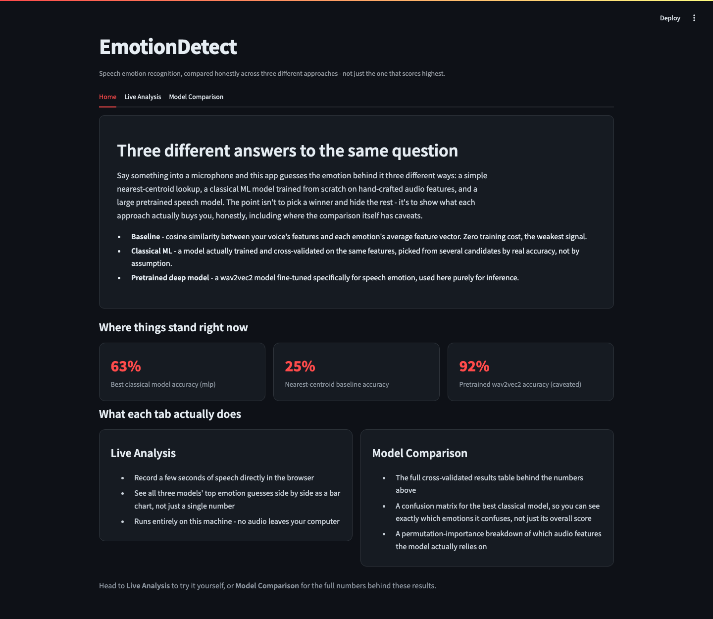
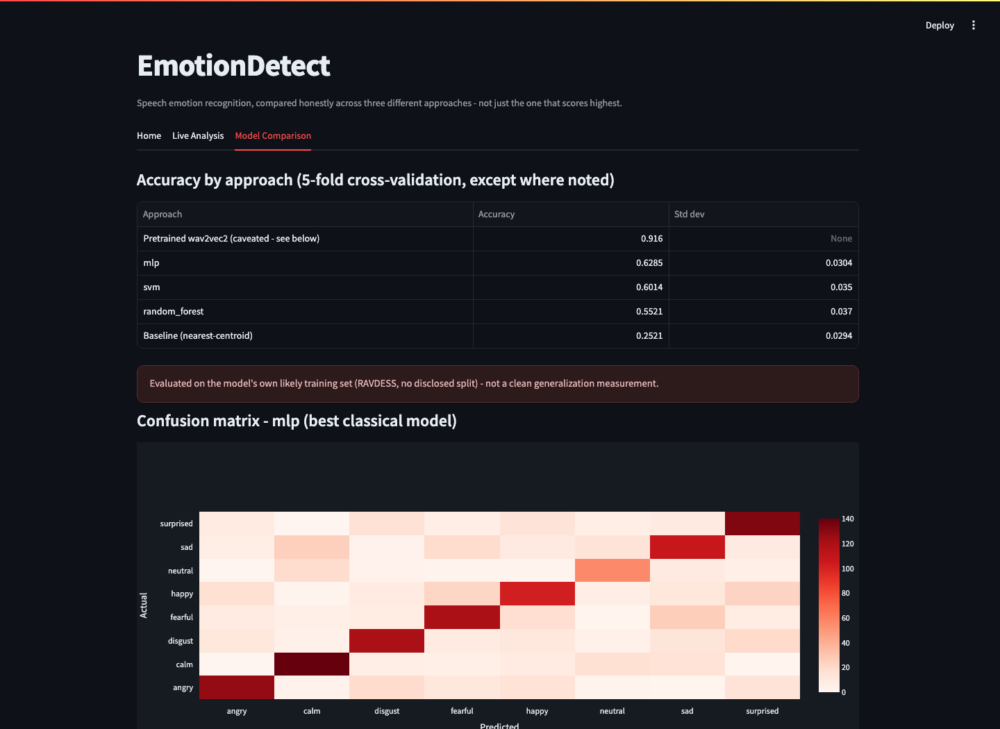

# EmotionDetect

Speech emotion recognition, compared honestly across three genuinely different approaches - a
zero-training nearest-centroid baseline, classical ML models trained and cross-validated from
scratch, and a pretrained deep model used purely for inference - rather than picking one method
and presenting it as the whole story.

## Why this exists

Most "emotion from voice" demos show one model and one accuracy number. The more interesting
question is what each *kind* of approach actually buys you: how much does real training add over
a naive similarity lookup? How much further does a large pretrained model get you, and is that
gap even measuring what it looks like? This project answers those questions with real
cross-validated numbers instead of taking any of them on faith.

## Screenshots

**Home** - real stats pulled from the generated results files, with an honest breakdown of what
each approach actually is:



**Model Comparison** - the full cross-validated results table, the pretrained model's caveat
front and center (not buried in a footnote), and a confusion matrix for the deployed model:



## How it works

**Features**: every clip is converted into 180 numbers - a 128-bin Mel-spectrogram, 40 MFCCs, and
12 chroma bins, each averaged over time (`AudioEmo.py`). These three feature families capture
different things: Mel/MFCCs are about the spectral envelope (closely tied to vocal tract shape
and prosody), chroma is about pitch class content.

**Baseline (nearest-centroid)** - `AudioEmo.py`'s original approach: compute each emotion's
average feature vector from the training data, then classify a new clip by cosine similarity to
the nearest one. Zero training cost, and a real (if weak) signal.

**Classical ML** - `classifier.py` trains an SVM, a Random Forest, and an MLP on the same
features, each cross-validated with stratified 5-fold CV rather than a single train/test split
(RAVDESS is small enough - 1440 samples - that one split can be noisy). The best-performing one
is serialized and used by the app.

**Pretrained deep model** - `pretrained.py` runs
[ehcalabres/wav2vec2-lg-xlsr-en-speech-emotion-recognition](https://huggingface.co/ehcalabres/wav2vec2-lg-xlsr-en-speech-emotion-recognition),
a wav2vec2 model fine-tuned specifically for this task, purely for inference - no training here.
Getting this to work correctly took more than `transformers.pipeline(...)`: see
[A real loading bug worth knowing about](#a-real-loading-bug-worth-knowing-about) below.

**Explainability** - `explainability.py` runs permutation importance on the best classical
model: shuffle one feature at a time and measure the accuracy drop. MFCCs dominate the top
features, consistent with the speech-emotion literature.

## Results

5-fold cross-validated accuracy (except the pretrained model - see the caveat below):

| Approach                              | Accuracy | Notes |
|----------------------------------------|----------|-------|
| Baseline (nearest-centroid)            | 25.2%    | `AudioEmo.py`'s original method, no training |
| Random Forest                          | 55.2%    | |
| SVM (RBF kernel)                       | 60.1%    | Calibrated for probability output |
| **MLP (best classical model)**         | **62.8%**| Deployed in the app |
| Pretrained wav2vec2                    | 91.6%    | Evaluated on all 1440 RAVDESS samples - see caveat below |

Random chance on 8 classes is 12.5%, so even the weak baseline is a real signal, and the jump
to a properly trained classical model roughly 2.5x's it.

### A real caveat on the pretrained number

The ehcalabres model's own model card confirms it was fine-tuned on this exact 1440-sample
RAVDESS set, with no disclosed train/test split. Evaluating it on the same 1440 samples used
here almost certainly includes clips it already saw during its own training - this is closer to
measuring memorization than generalization, and isn't a clean apples-to-apples comparison with
the classical models' cross-validated numbers above. The model's own card reports 82.2% on its
(undisclosed) internal eval split; the 91.6% measured here, on its full likely training pool, is
higher in exactly the direction that caveat predicts. It's still reported, with this caveat
attached front and center, because the honest comparison - including its limits - is more
useful than a flattering number with the limits hidden.

### A real loading bug worth knowing about

Loading the pretrained model through the standard `transformers.pipeline("audio-classification",
model=MODEL_ID)` *runs without error* but silently produces garbage: near-uniform ~12.5%
probability across all 8 classes on every input, regardless of what's actually said. The
checkpoint's classification head uses older key names (`classifier.dense` / `classifier.output`,
a two-layer head from an earlier wav2vec2 fine-tuning script) that don't match the generic
`Wav2Vec2ForSequenceClassification` architecture's expected names (`projector` / `classifier`).
`AutoModelForAudioClassification` loads this mismatch *silently* - it logs the unexpected/missing
keys but doesn't raise, and happily hands back a model with a freshly randomly-initialized head.
`pretrained.py` works around this by loading the wav2vec2 backbone and the checkpoint's real
`classifier.dense`/`classifier.output` weights by hand, confirmed against the checkpoint's actual
`model.safetensors` key names rather than assumed.

## Features

- **Three-way comparison**: baseline, classical ML, and a pretrained deep model, all on the same
  input, shown side by side rather than picking one
- **Real cross-validation**: every classical-model number is 5-fold CV, not a single lucky split
- **Explainability**: permutation importance shows which of the 180 audio features the deployed
  model actually relies on
- **Live recording**: record directly in the browser (`app.py`) and see all three models' guesses
  on your own voice
- **Everything runs locally** - no account, no API key, no audio leaves your machine (the
  pretrained model itself is downloaded once from Hugging Face, then cached locally)

## Project structure

```
AudioEmo.py          # feature extraction + nearest-centroid baseline (AudioEmotionRecognizer)
Generatedb.py         # builds Audio_db.pkl from db/RAVDESS/Actor_*/*.wav
classifier.py          # classical ML comparison (SVM/RF/MLP), 5-fold CV, saves the best model
pretrained.py           # wav2vec2 pretrained model, with the custom head-loading fix
explainability.py        # permutation importance on the deployed classical model
app.py                     # Streamlit frontend (recommended way to run this)
main.py                     # original CLI entry point (mic record -> baseline -> bar chart)
record.py                    # microphone recording (CLI mode)
conversion.py                 # mp4 -> wav helper (requires ffmpeg)
outputs/                       # saved results (JSON) + charts, generated by the scripts above
models/                         # the serialized best classical model (generated, not committed)
db/                               # RAVDESS dataset (NOT committed - see note below)
```

`db/` isn't committed - RAVDESS is freely available but large (~500MB); download it yourself (see
Setup below). `Audio_db.pkl` (the derived per-sample feature table) and `models/*.joblib` are also
generated locally, not committed, since they're fully reproducible from `db/`.

## Setup

```bash
python3 -m venv .venv
source .venv/bin/activate
pip install -r requirements.txt
```

**Get the dataset** (RAVDESS speech-only audio, ~200MB, CC BY-NC-SA 4.0):

```bash
mkdir -p db && cd db
curl -L -o ravdess_speech.zip "https://zenodo.org/record/1188976/files/Audio_Speech_Actors_01-24.zip"
mkdir RAVDESS && unzip ravdess_speech.zip -d RAVDESS && rm ravdess_speech.zip
```

**Build the feature database and train the models:**

```bash
python3 Generatedb.py      # builds Audio_db.pkl
python3 classifier.py       # trains + cross-validates SVM/RF/MLP, saves the best one
python3 explainability.py    # permutation importance on the deployed model
python3 pretrained.py         # pretrained wav2vec2 comparison (downloads the model on first run)
```

On macOS, the microphone recording path (`record.py`, and the live-recording feature in `app.py`)
needs `portaudio` as a system dependency: `brew install portaudio` before `pip install pyaudio`.

## Run it

**Streamlit app (recommended):**

```bash
streamlit run app.py
```

**Original CLI (single recording, bar chart + CSV log):**

```bash
python3 main.py
```

## Limitations

- RAVDESS is acted speech from 24 professional actors reading the same two fixed sentences -
  real-world speech is far more varied in content, accent, and recording conditions, so none of
  these accuracy numbers should be read as "how well this works on an arbitrary voice in the
  wild"
- The classical models' ~60-63% accuracy on 8 classes is solid relative to the 12.5% chance
  baseline, but well short of a production-grade system
- The pretrained model's accuracy is reported with the training-overlap caveat above - treat it
  as an upper-bound illustration, not a fair generalization measurement
- Hand-crafted features (Mel/MFCC/chroma, averaged over the whole clip) throw away all timing
  information within a clip; a sequence model (even a small RNN/1D-CNN over frame-level features)
  would likely do better than averaging everything into one vector

## What I'd improve with more time

- A proper held-out test set recorded separately from training data, instead of relying entirely
  on cross-validation over the same pool
- A second dataset (e.g. CREMA-D or TESS) to check whether what's learned here generalizes beyond
  RAVDESS's specific two sentences and 24 actors
- Frame-level (not averaged) features fed into a small sequence model, to use the timing
  information the current averaged-feature approach discards
- Fine-tuning the pretrained model on a proper held-out split, instead of only ever using it
  zero-shot for inference
