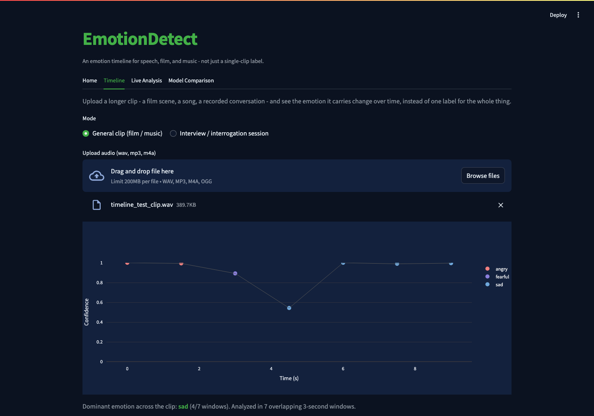
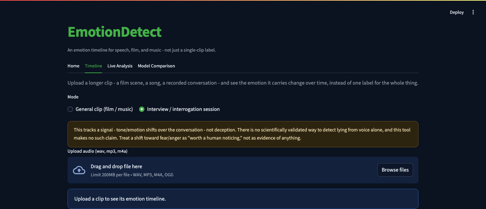

# EmotionDetect

An emotion timeline for audio - upload a film scene, a song, or a recorded conversation and see
how the emotion in it changes minute to minute, instead of getting one label for the whole clip.
Two framings of the same timeline: general clips (film/music) and interview/interrogation
sessions (with an explicit disclaimer that tone is a signal, not lie detection).

## Why this exists

Most "emotion from voice" demos classify one short clip and stop there - useful as a model demo,
not as something you'd actually use. The more interesting question is usually how emotion moves
over a *longer* recording: a scene that shifts from calm to tense, a song that builds, a
conversation that turns somewhere partway through. Timeline answers that by running the same
classifier over a sliding window instead of once per clip.

Getting there required real model work first - comparing a zero-training baseline, classical ML,
and a pretrained deep model, cross-validated honestly rather than picking whichever looked best
and presenting it as the whole story. That comparison is still here (Model Comparison tab), but
it's the engine behind Timeline now, not the headline.

## Screenshots

**Home**:


**Timeline** - a 12-second clip stitched from three different real emotions, correctly tracked
from angry through a noisy transition to sad:



**Timeline, interrogation mode** - same engine, explicit disclaimer shown up front:



**Model Comparison** - the full cross-validated results table behind Timeline's model, the
pretrained model's caveat front and center, and a confusion matrix:


## How it works

**Timeline** (`timeline.py`) - splits a clip into overlapping 3-second windows (1.5-second hop),
skips near-silent windows, and runs the same classical model used elsewhere in this project on
each one, producing one (timestamp, emotion, confidence) point per window. Tested against a real
stitched clip (angry → silence → happy → silence → sad): the timeline correctly reads "angry" at
the start and "sad" at the end, with noisier transitional labels exactly where two different
emotional clips blend together - the honest behavior you'd expect from averaging features over a
window that spans two different emotions, not a bug.

**Features**: every window is converted into 180 numbers - a 128-bin Mel-spectrogram, 40 MFCCs,
and 12 chroma bins, averaged over the window (`AudioEmo.py`/`timeline.py`). Mel/MFCCs capture the
spectral envelope (tied to vocal tract shape and prosody); chroma captures pitch class content.

**Baseline (nearest-centroid)** - `AudioEmo.py`'s original approach: cosine similarity to each
emotion's average feature vector. Zero training cost, the weakest of the three signals.

**Classical ML** - `classifier.py` trains an SVM, a Random Forest, and an MLP, each cross-validated
with stratified 5-fold CV. The best-performing one (an MLP) is what Timeline and Live Analysis
both actually run.

**Pretrained deep model** - `pretrained.py` runs
[ehcalabres/wav2vec2-lg-xlsr-en-speech-emotion-recognition](https://huggingface.co/ehcalabres/wav2vec2-lg-xlsr-en-speech-emotion-recognition)
purely for inference, for comparison. Getting this to work correctly took more than
`transformers.pipeline(...)` - see [the loading bug](#a-real-loading-bug-worth-knowing-about)
below.

**Explainability** - `explainability.py` runs permutation importance on the deployed model; MFCCs
dominate the top features, consistent with the speech-emotion literature.

## Results

5-fold cross-validated accuracy for the model Timeline/Live Analysis actually use (except the
pretrained model - see the caveat below):

| Approach                              | Accuracy | Notes |
|----------------------------------------|----------|-------|
| Baseline (nearest-centroid)            | 25.2%    | `AudioEmo.py`'s original method, no training |
| Random Forest                          | 55.2%    | |
| SVM (RBF kernel)                       | 60.1%    | Calibrated for probability output |
| **MLP (deployed in Timeline)**         | **62.8%**| |
| Pretrained wav2vec2                    | 91.6%    | Evaluated on all 1440 RAVDESS samples - see caveat below |

Random chance on 8 classes is 12.5%, so even the weak baseline is a real signal, and the jump
to a properly trained classical model roughly 2.5x's it.

### A real caveat on the pretrained number

The ehcalabres model's own model card confirms it was fine-tuned on this exact 1440-sample
RAVDESS set, with no disclosed train/test split. Evaluating it on the same 1440 samples used here
almost certainly includes clips it already saw during training - closer to measuring memorization
than generalization. The model's own card reports 82.2% on its internal eval split; the 91.6%
measured here, on its full likely training pool, is higher in exactly the direction that caveat
predicts.

### A real loading bug worth knowing about

Loading the pretrained model through the standard `transformers.pipeline("audio-classification",
model=MODEL_ID)` *runs without error* but silently produces garbage: near-uniform ~12.5%
probability across all 8 classes, regardless of what's actually said. The checkpoint's
classification head uses older key names (`classifier.dense`/`classifier.output`) that don't match
the generic `Wav2Vec2ForSequenceClassification` architecture's expected names
(`projector`/`classifier`). `AutoModelForAudioClassification` loads this mismatch *silently* and
hands back a model with a freshly randomly-initialized head. `pretrained.py` works around this by
loading the backbone and the checkpoint's real head weights by hand, confirmed against the
checkpoint's actual `model.safetensors` key names.

## Features

- **Timeline**: upload a longer clip, see emotion over time in two modes (general clip /
  interview-interrogation), not one label for the whole thing
- **Three-way model comparison**: baseline, classical ML, and a pretrained deep model, shown side
  by side rather than picking one and hiding the rest
- **Real cross-validation**: every classical-model number is 5-fold CV, not a single lucky split
- **Explainability**: permutation importance shows which of the 180 audio features the deployed
  model actually relies on
- **Live recording**: record a few seconds directly in the browser and see all three models' guesses
- **Everything runs locally** - no account, no API key, no audio leaves your machine

## Project structure

```
AudioEmo.py          # feature extraction + nearest-centroid baseline (AudioEmotionRecognizer)
Generatedb.py         # builds Audio_db.pkl from db/RAVDESS/Actor_*/*.wav
classifier.py          # classical ML comparison (SVM/RF/MLP), 5-fold CV, saves the best model
timeline.py             # sliding-window emotion-over-time analysis - Timeline's engine
pretrained.py            # wav2vec2 pretrained model, with the custom head-loading fix
explainability.py         # permutation importance on the deployed classical model
app.py                      # Streamlit frontend - Home / Timeline / Live Analysis / Model Comparison
main.py                      # original CLI entry point (mic record -> baseline -> bar chart)
record.py                     # microphone recording (CLI mode)
conversion.py                  # mp4 -> wav helper (requires ffmpeg)
outputs/                        # saved results (JSON) + charts, generated by the scripts above
models/                          # the serialized best classical model (generated, not committed)
db/                                # RAVDESS dataset (NOT committed - see note below)
```

`db/` isn't committed - RAVDESS is freely available but large (~500MB); download it yourself (see
Setup below). `Audio_db.pkl` and `models/*.joblib` are also generated locally, not committed,
since they're fully reproducible from `db/`.

## Setup

```bash
python3 -m venv .venv
source .venv/bin/activate
pip install -r requirements.txt
```

**Get the dataset** (RAVDESS speech-only audio, ~200MB, CC BY-NC-SA 4.0):

```bash
mkdir -p db && cd db
curl -L -o ravdess_speech.zip "https://zenodo.org/record/1188976/files/Audio_Speech_Actors_01-24.zip"
mkdir RAVDESS && unzip ravdess_speech.zip -d RAVDESS && rm ravdess_speech.zip
```

**Build the feature database and train the models:**

```bash
python3 Generatedb.py      # builds Audio_db.pkl
python3 classifier.py       # trains + cross-validates SVM/RF/MLP, saves the best one
python3 explainability.py    # permutation importance on the deployed model
python3 pretrained.py         # pretrained wav2vec2 comparison (downloads the model on first run)
```

On macOS, the microphone recording path needs `portaudio` as a system dependency:
`brew install portaudio` before `pip install pyaudio`. Timeline's file upload needs `ffmpeg` on
your PATH for non-wav formats (mp3/m4a/ogg) - `brew install ffmpeg`.

## Run it

**Streamlit app (recommended - includes Timeline):**

```bash
streamlit run app.py
```

**Original CLI (single recording, bar chart + CSV log):**

```bash
python3 main.py
```

## Limitations

- **Timeline's interrogation mode is explicitly not a lie detector** - there is no scientifically
  validated way to detect deception from voice alone, and the app says so directly rather than
  implying otherwise. It surfaces tone/emotion shifts; what they mean is a human judgment call.
- RAVDESS is acted speech from 24 professional actors reading the same two fixed sentences -
  real-world speech is far more varied, so none of these accuracy numbers should be read as "how
  well this works on an arbitrary voice in the wild"
- Timeline's sliding window averages features over 3 seconds - a window spanning a genuine
  emotional transition will read as noisier/less confident, not wrong, which is the correct
  behavior for an averaged-feature approach rather than a limitation to hide
- The pretrained model's accuracy is reported with the training-overlap caveat above - treat it
  as an upper-bound illustration, not a fair generalization measurement

## What I'd improve with more time

- Speaker diarization for interrogation-mode audio with multiple speakers, so the timeline could
  separate "interviewer" from "subject" instead of treating the whole conversation as one voice
- A proper held-out test set recorded separately from training data, instead of relying entirely
  on cross-validation over the same pool
- Frame-level (not averaged) features fed into a small sequence model, to use the timing
  information the current averaged-feature approach discards
- A second dataset (e.g. CREMA-D or TESS) to check whether what's learned here generalizes beyond
  RAVDESS's specific two sentences and 24 actors
